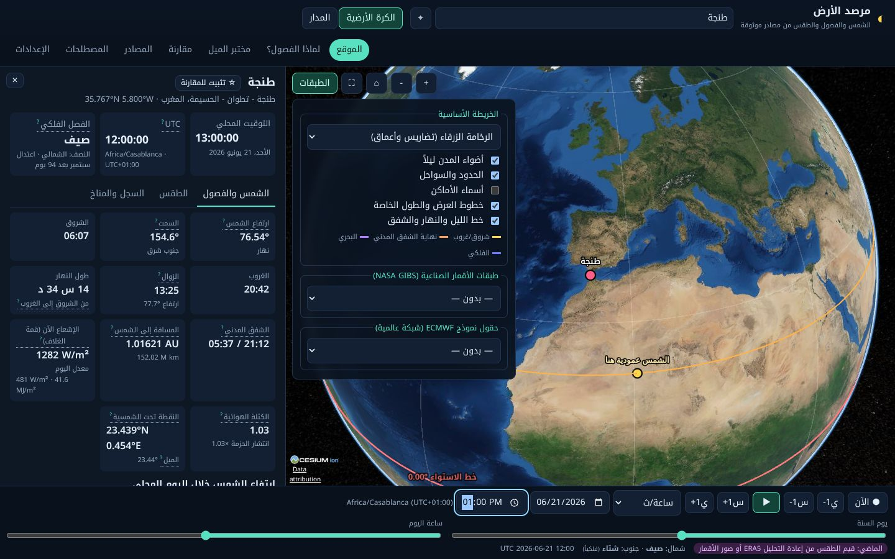

# مرصد الأرض — Earth & Weather Explorer

تطبيق ويب علمي باللغة العربية (RTL افتراضياً، مع واجهة إنجليزية). يضم:

- كرة أرضية ثلاثية الأبعاد تفاعلية.
- محاكاة فلكية دقيقة للشمس والفصول تعمل دون اتصال.
- بيانات طقس حقيقية من مصادر موثوقة، مع بيان مصدر كل قيمة ونوعها: رصد، استرجاع ساتلي، تحليل، توقع، إعادة تحليل، معدلات مناخية، أو محاكاة.



## التشغيل

```bash
cd earth-observatory
npm install
npm run dev          # http://localhost:5173  (خادم التطوير مع وسيطات API)
npm test             # 42 اختباراً (الفلك + طبقة البيانات)
npm run build        # بناء الإنتاج في dist/
npm start            # خادم الإنتاج: http://localhost:8080 (PORT=… لتغيير المنفذ)
```

يتطلب Node.js 20 أو أحدث. **لا يحتاج أي مفتاح API.** كل المصادر عامة ومجانية.

يحتوي الملف `.env.example` على متغيرين اختياريين:

- `VITE_CESIUM_ION_TOKEN`: غير مستخدم افتراضياً.
- `CONTACT`: نص تعريفي يُرسل في User-Agent لطلبات الخادم.

### لماذا يوجد خادم صغير؟

واجهتان عامتان لا تُرسلان ترويسات CORS، فلا يستطيع المتصفح قراءتهما مباشرة:

- أرصاد المطارات METAR من NOAA AWC.
- ملف وقت تشغيل نموذج ECMWF من Open-Meteo.

لذلك يمرّرهما `server/relay.mjs`، وهو مدمج في `npm run dev` و`npm start`. الوسيط:

- يقبل استعلامات محددة فقط.
- يخزّن الردود 5 دقائق ويحدّ عدد الطلبات.
- لا يحمل أي أسرار.

## النسخة العامة على الهاتف (GitHub Pages)

**الرابط:** https://elkhachtoufossama10-web.github.io/Ossama/earth/

افتحه في المتصفح، ثم اختر «إضافة إلى الشاشة الرئيسية» ليعمل كتطبيق. لا يحتاج خادماً ولا حساباً ولا أي تكلفة. البنية كلها على GitHub:

| الجزء | الملف | ما يفعله |
|---|---|---|
| النشر | `.github/workflows/earth-deploy.yml` | عند كل تعديل على `earth-observatory/` يشغّل الاختبارات، ثم يبني النسخة الثابتة وينسخها إلى `earth/` في فرع `master`، فينشرها GitHub Pages. |
| تحديث البيانات | `.github/workflows/earth-data.yml` و `scripts/data_snapshot.py` | كل ~20 دقيقة: ينزّل ملف NOAA الرسمي لكل أرصاد المطارات في العالم (نحو 5200 محطة)، ويقسمه إلى مربعات 10°×10°، ومعه وقت تشغيل نموذج ECMWF. يضع ذلك في فرع `data` كإيداع واحد يُستبدل كل مرة، فلا يكبر السجل. |
| القراءة | `src/sources/config.ts` | عند البناء بالمتغير `VITE_DATA_SNAPSHOT_URL` يقرأ التطبيق هذين المصدرين من `raw.githubusercontent.com` (يسمح بالطلب من المتصفح) بدلاً من `/api`. |

بقية المصادر (ECMWF و ERA5 و NASA GIBS والبحث) يطلبها الهاتف مباشرة كما في النسخة المحلية.

**حدود:** جدولة GitHub قد تتأخر أحياناً بضع دقائق. وتتوقف المهام المجدولة تلقائياً إذا لم يحدث أي تعديل على المستودع لمدة 60 يوماً؛ يعيد أي إيداع أو زر «Run workflow» تشغيلها. عمر الرصد يُعرض دائماً، ويظهر تحذير إذا كان قديماً.

## الميزات

| الجزء | ما يفعله |
|---|---|
| **الكرة الأرضية** (CesiumJS 1.146) | تدوير وتكبير، ونقر لاختيار نقطة، وبحث عن مدن أو إحداثيات، وزر «موقعي» لا يطلب الإذن إلا عند الضغط. يرسم خط الاستواء والمداري ±ε والدائرتين القطبيتين 90°−ε (محسوبة من ميل المحور لذلك التاريخ)، وخط الشروق والغروب (−0.833°) وخطوط الشفق المدني والبحري والفلكي، والنقطة تحت الشمسية، وأضواء المدن على الجانب الليلي، وملء الشاشة. |
| **الشمس** | ارتفاع الشمس وسمتها، والشروق والغروب والزوال، والشفق المدني، وطول النهار، والمسافة إلى الشمس، والإشعاع فوق الغلاف الجوي الآن ومعدل اليوم، والكتلة الهوائية، والتوقيت المحلي و UTC مع فرق المنطقة الزمنية والتوقيت الصيفي، والفصل الفلكي لكل نصف كرة. يعرض أيضاً منحنى ارتفاع الشمس خلال اليوم، ومنحنيات السنة، ومقارنة مستقلة مع شروق وغروب Open-Meteo. |
| **شريط الزمن** | «الآن»، وتشغيل وإيقاف، وسرعات من زمن حقيقي إلى شهر لكل ثانية، و±ساعة/يوم، ومنزلقا يوم السنة وساعة اليوم، ومن 1900 إلى 2100. يشير إلى نوع البيانات المتاحة للحظة المختارة: الحاضر، أو توقع، أو بعد نهاية التوقع، أو الماضي. |
| **الطقس** | توقع ECMWF IFS الساعي واليومي حتى نهاية مداه الفعلي، دون أي امتداد. القيم المعروضة للحظة المختارة، مع مدة التوقع وتحذير بعد 5 أيام. أقرب رصد فعلي (METAR) ضمن 80 كم. للماضي: ERA5 الساعي. |
| **التحذيرات** | NWS آلياً داخل الولايات المتحدة. في غيرها روابط رسمية فقط: Maroc Météo و MeteoAlarm و WMO SWIC، ولا تُخترع تحذيرات. |
| **الطبقات** | من NASA GIBS: صورة الأقمار بالألوان الحقيقية لأي يوم، والغطاء السحابي (MODIS)، والهطول كل 30 دقيقة (IMERG)، وحرارة ورطوبة سطحية (AIRS)، ومتوسط شهري (MERRA-2)، ولكل طبقة مفتاح ألوانها الرسمي والتاريخ المطلوب والتاريخ المعروض فعلاً (من ترويسة `Layer-Time-Actual`). ومن ECMWF: سبعة حقول عالمية (الحرارة، المحسوسة، السحب، الهطول، الرياح، الضغط، الرطوبة) لأي ساعة ضمن مدى التوقع، مع مفتاح ألوان. |
| **السجل والمناخ** | آخر 60 يوماً من ERA5، والمعدلات الشهرية 1991–2020 محسوبة من ERA5 اليومي (تُحفظ على الجهاز)، ومقارنة الكبرى المتوقعة بمعدل الشهر. |
| **لماذا الفصول؟** | موقعان في اللحظة نفسها (مثل طنجة وكيب تاون) مع ارتفاع الشمس عند الزوال، وطول النهار، والإشعاع اليومي، والكتلة الهوائية، والمسافة (متساوية للموقعين). رسم لانتشار حزمة الضوء ومنحنى الإشعاع السنوي، وتنبيه علمي عن العوامل الأخرى. |
| **مختبر الميل** | ميل 0° أو 23.44° أو 45° أو أي قيمة حتى 60°. مُعلَّم بوضوح أنه **افتراضي**. يقارن طول النهار والإشعاع بالحقيقي، ويعرض جدول الانقلابين ورسماً للمحور. |
| **منظر المدار** | المدار الحقيقي في إطار الكسوف J2000، والاعتدالان والانقلابان والحضيض والأوج (بالنقر)، والمحور ثابت الاتجاه، ومنظر جانبي لميل المحور نحو الشمس، وتشغيل السنة بسرعة قابلة للتعديل. |
| **مقارنة المواقع** | حتى 6 مواقع مثبّتة، بالوقت المحلي وارتفاع الشمس وطول النهار والفصل والحرارة المتوقعة. |
| **المصادر والمصطلحات والإعدادات** | سجل حي لمصدر كل ما يظهر على الشاشة: المنتِج والمزوّد والنموذج، ووقت التشغيل والصلاحية والجلب، والتغطية والدقة والشروط، وتحذير «بيانات قديمة». شرح منبثق لـ 26 مصطلحاً. الوحدات، واللغة، وUTC أو التوقيت المحلي، وإيقاف البحث العكسي عن الأسماء، وحذف البيانات المحلية. |

## المصادر المستخدمة فعلاً (تم التحقق من كل واحد منها)

| المصدر | المنتِج | الوصول | النوع | الشروط |
|---|---|---|---|---|
| ECMWF IFS 0.25° open data | ECMWF | Open-Meteo Forecast API `models=ecmwf_ifs025` | توقع | CC BY 4.0 |
| ERA5 | ECMWF لصالح Copernicus C3S | Open-Meteo Archive API `models=era5` | إعادة تحليل ومعدلات | Copernicus + CC BY 4.0 |
| NASA GIBS (WMTS EPSG:3857) | NASA ESDIS: VIIRS، MODIS، AIRS، GPM IMERG، MERRA-2، Blue/Black Marble | مباشرة (CORS) | رصد، استرجاع، تحليل، إعادة تحليل | NASA open data |
| METAR | المحطات الوطنية عبر NOAA Aviation Weather Center | `server/relay.mjs` | رصد | ملكية عامة |
| NWS api.weather.gov | NOAA | مباشرة | تحذيرات ورصد (الولايات المتحدة) | ملكية عامة |
| Open-Meteo Geocoding | GeoNames | مباشرة | بحث | CC BY 4.0 |
| Nominatim | OpenStreetMap | مباشرة، طلب واحد كل ثانية على الأكثر، إحداثيات مقربة | اسم المكان | ODbL |
| astronomy-engine 2.1.19 | Don Cross (VSOP87، IAU 2006) | مكتبة محلية | محاكاة | MIT |
| tz-lookup | timezone-boundary-builder | مكتبة محلية | المنطقة الزمنية | MIT/ODbL |

قوائم طبقات GIBS (المعرّف، ومجموعة البلاطات، والصيغة، والمدى الزمني، والمفتاح) مستخرجة من وثيقة GetCapabilities الرسمية بواسطة `scripts/gibs_layers.py`.

### مصادر طُلبت ولم تُستخدم مباشرة، ولماذا

- **Maroc Météo (المديرية العامة للأرصاد الجوية):** لم نجد واجهة برمجية عامة موثقة، والموقع لم يكن متاحاً من بيئة البناء. لم نخترع عنوان API ولم نستخرج البيانات من الموقع، ووضعنا رابطاً مباشراً لنشراته الرسمية للمواقع داخل المغرب.
- **ملفات ECMWF GRIB2 مباشرة:** ضخمة وغير مناسبة للمتصفح. البيانات نفسها تأتي عبر Open-Meteo، ويُذكر المنتِج والمزوّد كلٌّ باسمه.
- **Copernicus CDS:** يتطلب مفتاحاً شخصياً وطابوراً غير متزامن، لذلك يأتي ERA5 عبر أرشيف Open-Meteo.
- **تحذيرات عالمية:** لا توجد واجهة عالمية مفتوحة موحدة يمكن طلبها من المتصفح.

## الدقة والاختبارات

`npm test` → **42/42 ناجحة**:

| الاختبار | المرجع | التسامح |
|---|---|---|
| اعتدالا وانقلابا 2024 (USNO: 20/3 03:06، 20/6 20:51، 22/9 12:44، 21/12 09:20 UTC) | USNO | أقل من دقيقتين |
| الحضيض والأوج 2024 | — | — |
| النقطة تحت الشمسية: +23.44° في يونيو، −23.44° في ديسمبر، 0° في الاعتدالين؛ والشمس فوق الرأس عندها | — | — |
| ميل المحور: 23.4393° عند J2000 | IAU 2006 | — |
| شروق وغروب غرينتش في 21/6/2024 | NOAA | ±3 دقائق |
| شروق طنجة وطول نهارها في 21/12 | — | — |
| نهار خط الاستواء في الاعتدال ≈ 12 س 07 د | — | — |
| شمس منتصف الليل والليل القطبي في ترومسو والقطب الجنوبي | — | — |
| الإشعاع اليومي: القطب الشمالي في الانقلاب ≈ 520 W/m² > الاستواء ≈ 385 W/m²؛ تطابق المعادلة التحليلية مع التكامل العددي | — | < 1% |
| الكتلة الهوائية (Kasten–Young) وتصنيف الشفق | — | — |
| المحور ثابت الاتجاه في الفضاء: تغيّر أقل من 0.01° خلال السنة، وزاوية 23.44° مع عمود الكسوف | — | — |
| المناطق الزمنية: طنجة Africa/Casablanca، كيب تاون Africa/Johannesburg، وتوقيت نيويورك الصيفي ومنتصف ليل سيدني | — | — |
| ردود Open-Meteo الصحيحة والناقصة؛ تحويل القيم المستحيلة فيزيائياً إلى فجوات | — | — |
| حساب المعدلات المناخية، وتحليل الإحداثيات، واختيار تاريخ GIBS، والتقادم (لا يُعتبر الماضي المطلوب عمداً قديماً)، والرطوبة من نقطة الندى، والمسافات | — | — |

فحص المتصفح الآلي (`scripts/smoke-browser.cjs`) يمرّ على كل اللوحات، وعلى الواجهتين العربية والإنجليزية، وعلى شاشة هاتف، دون أخطاء JavaScript. التحقق المستقل داخل التطبيق: شروق وغروب Open-Meteo يُقارنان بحسابنا، والفرق بالثواني يُعرض.

## البنية

```
src/astro/       solar.ts (الشمس والفصول والمدار والميل الافتراضي)، time.ts (المناطق الزمنية دون اتصال)، والاختبارات
src/sources/     طبقة لكل مصدر: openMeteo، era5، nws، metar، gibs، geocoding
                 http.ts: مهلة، إعادة محاولة مع Retry-After، تخزين مؤقت، تحقق إلزامي من الرد
                 provenance.ts: نوع البيانات وبيانات المصدر لكل قيمة
src/globe/       Cesium (طبقات GIBS، الإضاءة، الخطوط، تسميات عربية مرسومة بمحرك نصوص المتصفح)، تلوين حقول النموذج
src/ui/          اللوحات، والرسوم البيانية (uPlot)، والمصطلحات، والإعدادات
server/          relay.mjs (وسيطا METAR وبيانات النموذج)، server.mjs (خادم الإنتاج)
```

**ملاحظة على الطلب الأصلي:** طُلب Next.js «عند الحاجة». اخترنا Vite + React + TypeScript مع خادم Node صغير، لأن كل المصادر مجانية ولا تحتاج مفاتيح، ومعظمها يسمح بالطلب من المتصفح. لا توجد أسرار تستوجب خادماً كاملاً، والوسيطان الوحيدان المطلوبان يكفيهما ملف واحد.

## الخصوصية

- لا حسابات، ولا تحليلات، ولا ملفات تعريف تتبع.
- التفضيلات والمواقع المثبتة في `localStorage` على جهازك فقط.
- موقع الجهاز يُطلب فقط عند الضغط على ⌖، ويُقرَّب إلى ~1 كم.
- الإحداثيات تُرسل مقربة إلى مصادر الطقس، لأنها ضرورية لجلب بيانات المكان.
- تُرسل كذلك إلى Nominatim لمعرفة الاسم، ويمكن إيقاف ذلك من الإعدادات.

## ما لم يُنفَّذ (حدود معروفة)

- **الشبكة العالمية لـ ECMWF:** عيّنة كل 10° (612 نقطة)، لأن Open-Meteo مجاني بحدود يومية. تكفي لنظرة عامة فقط، والدقة الكاملة متاحة عند نقر أي نقطة.
- **الرياح والضغط:** لا أسهم ولا جزيئات متحركة للرياح، ولا خطوط تساوي الضغط. تُعرض سرعة الرياح والضغط كحقول ملونة.
- **التحذيرات:** آلية فقط في الولايات المتحدة، وفي غيرها روابط رسمية.
- **Maroc Météo:** لا توجد بيانات منه داخل التطبيق (السبب أعلاه).
- **التضاريس:** لا تضاريس ثلاثية الأبعاد (تحتاج Cesium ion)، والكرة إهليلجية ملساء.
- **حدود العرض:** طبقات GIBS بإسقاط Web Mercator، فلا تُعرض الصور فوق ±85°. خطوط الإضاءة والحسابات تغطي القطبين.
- **عدم اليقين:** لا توقعات مجموعات (ensemble)، ولا نطاقات عدم يقين، ولا سلاسل زمنية تاريخية لمحطات الرصد.
- **العمل دون اتصال:** لا يوجد عامل خدمة (service worker). الحسابات الفلكية تعمل دون اتصال، لكن الصفحة نفسها تحتاج اتصالاً لأول تحميل.
- **مختبر الميل:** يعرض النتائج في الرسوم والجداول فقط، ولا يغيّر إضاءة الكرة.

---

### English summary

Earth Observatory is an Arabic-first (RTL) scientific web app built with React, TypeScript, Vite, CesiumJS, astronomy-engine and uPlot.

- **Astronomy:** offline sun, season and orbit simulation, tested against USNO and NOAA references (42 tests).
- **Real data:** ECMWF IFS forecasts and ERA5 reanalysis (both via Open-Meteo), NASA GIBS satellite layers, worldwide METAR observations and US NWS alerts.
- **Provenance:** every value shows its producer, provider, run time, valid time, fetch time, coverage, resolution and terms, plus a staleness warning.
- **Setup:** no API keys. Run `npm install && npm run dev`, or for production `npm run build && npm start`.
